<p align="center">
  
</p>

<p align="center">
  
  
  
  
  
</p>

Cleans 200 messy booking records from legacy systems and summarises revenue, length of stay and booking status per property.

## 🚀 Quick start

Requires [uv](https://docs.astral.sh/uv/).

```bash
uv sync                                  # install dependencies
uv run dbt build --profiles-dir .        # build models + run tests
```

Outputs land in `output/`:

| File | Contents |
|---|---|
| `bookings_clean.parquet` | Clean dataset, one row per booking |
| `property_summary.parquet` | Summary table, one row per property |

<details>
<summary>Other commands</summary>

```bash
uv run sqlfluff lint models/ tests/      # lint SQL
uv run duckdb -cmd "ATTACH 'holiday_lettings.duckdb' AS lettings (READ_ONLY)" -ui   # browse results in the DuckDB UI
uv run python scripts/make_readme_assets.py   # regenerate the README images
```

The UI locks the database file, so close it before running `dbt build`.

</details>

## 🔀 Pipeline

<p align="center">
  
</p>

| Step | What it does |
|---|---|
| 📄 **Raw CSV** | Read as a dbt source with every column as text, so nothing is lost to type guessing. |
| 🧹 **stg_bookings** | Standardises and casts: trims names, lowercases status, parses both date formats, strips `$` from money. |
| 🧩 **bookings_clean** | Fills gaps using *total = daily rate × nights*, and flags every derived value. |
| 📊 **property_summary** | Aggregates per property: revenue, average stay, and booking counts by status. |

## 🧩 Filling the gaps

67 check-ins, 34 rates and 23 totals are blank in the raw file. Instead of dropping those rows or guessing, `bookings_clean` derives what it can from one rule found in the data:

<p align="center">
  
</p>

Every derived value sets a flag (`is_check_in_imputed`, `is_rate_imputed` or `is_total_imputed`), so a recorded value can always be told apart from a calculated one.

## 🧠 Key assumptions

- 💰 **Revenue = completed bookings only.** Cancelled bookings aren't charged, and pending ones aren't earned yet.
- ⏳ **Pending bookings are reported separately.** All 42 are stays that ended in 2023, so their status was most likely never updated in the legacy system. They're flagged as a data-quality issue rather than reassigned.
- 🛏️ **Average stay = completed bookings only**, the same as revenue. Cancelled stays never happened, and pending ones may not have. Completed stays whose length can't be derived (7) are excluded.
- 🚫 **Nothing is guessed.** Values that can't be derived stay NULL. As a result, revenue is slightly understated: 4 completed bookings have no value.

<details>
<summary>🔍 Data issues found and how they're handled</summary>
<br>

| Column | Issue | Handling |
|---|---|---|
| `guest_name` | Leading/trailing spaces on every row | `TRIM` |
| `status` | `cancelled` / `Cancelled`, `Completed` / `COMPLETED`, `Pending` | `LOWER` |
| `check_in_date`, `check_out_date` | Mixed ISO and `dd/mm/yyyy`; 67 check-ins blank | `STRPTIME` with both formats |
| `daily_rate_usd` | 34 blank | Derived as total ÷ nights |
| `total_booking_value` | 23 blank; `$` prefixes and padding | Strip `$`, cast; derived as rate × nights |

Only issues present in the data are cleaned. Casts are strict, so an unseen format fails the build instead of silently becoming NULL.

<p align="center">
  
</p>

</details>

<details>
<summary>✅ Data quality checks</summary>
<br>

`dbt build` runs 16 tests:

- `unique` / `not_null` on `booking_id`; `not_null` on property and check-out
- `accepted_values` on `status`, in staging and in the final dataset
- `assert_check_out_after_check_in`: every stay ends after it starts
- `assert_total_equals_rate_times_nights`: raw and derived values agree
- `assert_no_bookings_lost`: raw rows = clean rows = sum of summary counts (200)

In addition, the summary was recalculated independently in plain Python from the raw CSV, and it matched on every property and column.

</details>

<details>
<summary>🏗️ Design choices</summary>
<br>

- **Source, not seed.** Seeds are for static reference data. This is raw input with mixed types, so it's read as text and cast in one place.
- **No intermediate layer.** With a single source it would only pass rows through.
- **Marts are `external`.** dbt-duckdb writes each one to Parquet and creates a view over it in `holiday_lettings.duckdb`.
- **SQL style** is enforced by sqlfluff: uppercase keywords, aligned aliases, table aliases of 3+ characters.

</details>

## 🤖 AI usage

I used Claude Code as a pair programmer. `PLAN.md` and `CLAUDE.md` were written and committed first, so design decisions and rules (e.g. never invent data, never modify raw data) were fixed before any code was generated. Every change was checked by tests and lint before I committed it.

<details>
<summary>What AI did, what I changed, and how it was verified</summary>
<br>

**What AI did:** profiled the raw file, drafted the plan, scaffolded the dbt project, configured sqlfluff, drafted the mart models and tests, ran verification queries, and generated the README images.

**What I decided or changed:**
- Chose dbt + DuckDB, and later switched from pip to uv.
- Simplified the first AI staging model. It wrapped every column in `NULLIF`/`TRIM` and used `CASE` blocks for dates. Testing against the data showed DuckDB already reads empty fields as NULL and only `guest_name` was padded, so it became a single `SELECT`.
- Removed pass-through "import" CTEs and reduced `bookings_clean` to one CTE.
- Dropped an unrequested gross-value column and the CSV export.
- Questioned whether pending bookings should count as revenue, which surfaced the "all pending stays are in the past" finding.

**How the output was verified:**
- dbt tests plus sqlfluff on every change.
- An independent Python recalculation of the summary, written without reusing any of the SQL.
- A before/after diff of all 200 rows when refactoring `bookings_clean`. The output was identical.
- Spot checks of individual rows against the raw file.

</details>
